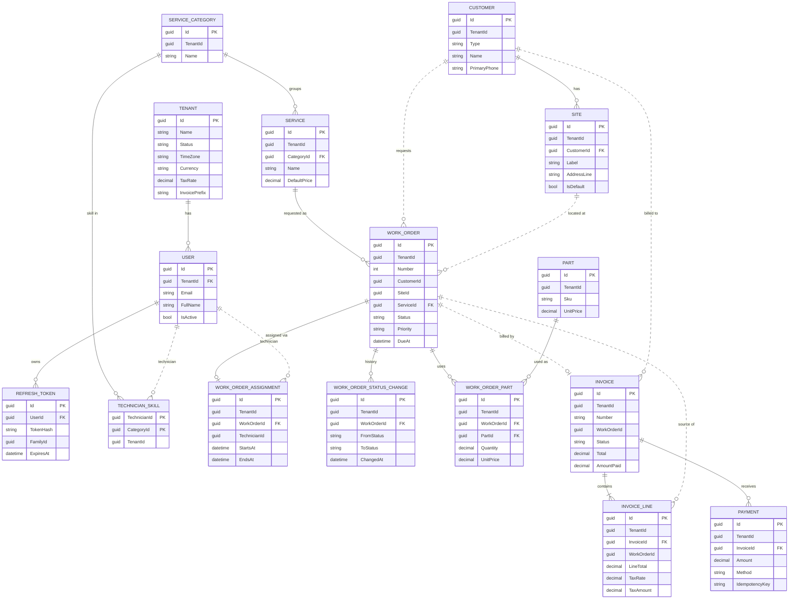

# Domain Model

This document defines the MVP data model: entities, aggregates, relationships and the integrity rules enforced by the application and the database.
Requirements are in [USER_STORIES.md](USER_STORIES.md).

## Conventions

| Topic | Convention |
|---|---|
| Primary keys | `Guid` (version 7, time-ordered) generated by the application |
| Human-readable numbers | Separate per-tenant sequential numbers (`WO-1042`, `INV-2026-0318`) |
| Tenant ownership | Every tenant-owned table, including child tables, has a non-null `TenantId`, indexed, and filtered automatically in queries |
| Audit columns | `CreatedAt`, `CreatedBy`, `ModifiedAt`, `ModifiedBy` on business entities (UTC `datetimeoffset`) |
| Concurrency | `RowVersion` (`rowversion`) on aggregates edited concurrently: `WorkOrder`, `Invoice` |
| Money | `decimal(18,2)`; quantities `decimal(18,3)`; tax rates `decimal(5,4)` (e.g. `0.1400`) |
| Rounding | Calculated amounts are rounded to 2 decimals, midpoint away from zero, per invoice line; totals are sums of rounded line values |
| Deletion | Business records are deactivated (`IsActive = false`), not deleted, once referenced |
| Enums | Stored as strings for readability (`nvarchar`), mapped to C# enums |
| Schemas | One SQL schema per module: `identity`, `customers`, `operations`, `billing` |
| Cross-module references | By Id only — no navigation properties and no foreign keys across modules; integrity checked by the owning module |

---

## Identity module (`identity` schema)

### Tenant *(aggregate root)*
| Field | Notes |
|---|---|
| Id | |
| Name | Required |
| Status | `Active`, `Suspended` |
| TimeZone | IANA id, e.g. `Africa/Cairo` |
| DefaultLanguage | `en`, `ar` |
| Currency | ISO 4217, e.g. `EGP` |
| TaxRate | e.g. `0.1400` |
| InvoicePrefix | e.g. `INV` |

### User *(ASP.NET Core Identity user, extended)*
| Field | Notes |
|---|---|
| Id, Email, PasswordHash, … | Provided by Identity |
| TenantId | Null only for Platform Admins |
| FullName, PhoneNumber | |
| IsActive | Deactivated users cannot sign in |
| PreferredLanguage | `en`, `ar` |
| MustChangePassword | Set when created with a temporary password |

Roles use Identity roles: `PlatformAdmin`, `TenantAdmin`, `Dispatcher`, `Technician`. One role per user in the MVP.

### RefreshToken
| Field | Notes |
|---|---|
| Id, UserId | Owned by the user; not filtered by tenant (Platform Admins have no tenant) |
| TokenHash | Only a hash is stored, never the raw token |
| FamilyId | Groups rotated tokens; reuse of an old token revokes the family |
| ExpiresAt, CreatedAt, RevokedAt | |
| ReplacedByTokenId | Set on rotation |

---

## Customers module (`customers` schema)

### Customer *(aggregate root)*
| Field | Notes |
|---|---|
| Id, TenantId | |
| Type | `Individual`, `Business` |
| Name | Required |
| PrimaryPhone | Required |
| SecondaryPhone, Email | Optional |
| IsActive | |

Phone numbers are normalized before saving (digits only, with an optional leading `+`), and search input is normalized the same way, so `0100 123 4567` and `01001234567` match.
Indexes `(TenantId, Name)`, `(TenantId, PrimaryPhone)` and `(TenantId, SecondaryPhone)` support customer search.

### Site *(part of the Customer aggregate)*
| Field | Notes |
|---|---|
| Id, TenantId, CustomerId | |
| Label | e.g. "Main office", "Apartment" |
| AddressLine, Area, City | |
| AccessNotes | Optional |
| IsDefault | At most one default site per customer |

---

## Operations module (`operations` schema)

### ServiceCategory
`Id`, `TenantId`, `Name` (unique per tenant), `IsActive`

### Service
`Id`, `TenantId`, `CategoryId`, `Name`, `DefaultPrice`, `EstimatedDurationMinutes`, `IsActive`

### Part
`Id`, `TenantId`, `Sku` (unique per tenant), `Name`, `Unit`, `UnitPrice`, `IsActive`

### TechnicianSkill
`TenantId`, `TechnicianId` (user id), `CategoryId` — composite key `(TechnicianId, CategoryId)`

### WorkOrder *(aggregate root)*
| Field | Notes |
|---|---|
| Id, TenantId | |
| Number | Integer, sequential per tenant, displayed as `WO-1042`; unique `(TenantId, Number)` |
| CustomerId, SiteId | References to the Customers module |
| ServiceId | |
| ServiceName, ServicePrice | Snapshot taken when the work order is created |
| Description | Problem reported |
| Priority | `Low`, `Medium`, `High` |
| Status | `New`, `Scheduled`, `EnRoute`, `InProgress`, `Completed`, `Cancelled` |
| DueAt | |
| TechnicianNotes | Optional; editable by the assigned technician until the work order is completed |
| CompletionSummary | Required when completed |
| CancellationReason | Required when cancelled |
| RowVersion | Optimistic concurrency |

### WorkOrderAssignment *(part of the WorkOrder aggregate)*
| Field | Notes |
|---|---|
| Id, TenantId, WorkOrderId | Unique `WorkOrderId` in the MVP (one technician) |
| TechnicianId | |
| StartsAt, EndsAt | `StartsAt < EndsAt` |

Index `(TenantId, TechnicianId, StartsAt, EndsAt)` supports the overlap check. SQL Server has no built-in "no overlapping ranges" constraint, so double booking is prevented by checking for overlaps inside a transaction that locks the technician's schedule range. Assignments of completed or cancelled work orders are kept for history but ignored by the overlap check, so a job finished early frees the rest of its time window.
Rescheduling or changing the technician updates the existing row; unassigning removes it and returns the work order to `New`.

### WorkOrderStatusChange *(part of the WorkOrder aggregate, append-only)*
`Id`, `TenantId`, `WorkOrderId`, `FromStatus`, `ToStatus`, `ChangedAt`, `ChangedBy`, `Note`

### WorkOrderPart *(part of the WorkOrder aggregate)*
`Id`, `TenantId`, `WorkOrderId`, `PartId`, `PartName` (snapshot), `Quantity` (> 0), `UnitPrice` (snapshot)

---

## Billing module (`billing` schema)

### Invoice *(aggregate root)*
| Field | Notes |
|---|---|
| Id, TenantId | |
| Number | Null while Draft; formatted on issue as `{InvoicePrefix}-{Year}-{Sequence}` and stored as text, so later prefix changes do not affect issued invoices |
| WorkOrderId | Source work order (must be Completed) |
| CustomerId | |
| CustomerName | Snapshot |
| Status | `Draft`, `Issued`, `PartiallyPaid`, `Paid`, `Void` |
| Currency | Snapshot from tenant |
| Subtotal | Sum of line `LineTotal` |
| TaxTotal | Sum of line `TaxAmount` |
| Total | `Subtotal + TaxTotal` |
| AmountPaid | Sum of payments; `0 ≤ AmountPaid ≤ Total` |
| IssuedAt, VoidedAt, VoidReason | |
| RowVersion | Optimistic concurrency |

### InvoiceLine *(part of the Invoice aggregate)*
| Field | Notes |
|---|---|
| Id, TenantId, InvoiceId | |
| WorkOrderId | Source work order of the line |
| Description | |
| Quantity, UnitPrice | |
| LineTotal | `Quantity × UnitPrice`, rounded, excluding tax |
| TaxRate | Taken from tenant settings; re-applied when the invoice is issued, then never changed |
| TaxAmount | `LineTotal × TaxRate`, rounded |

### Payment *(part of the Invoice aggregate)*
| Field | Notes |
|---|---|
| Id, TenantId, InvoiceId | |
| Amount | > 0 |
| PaidAt | |
| Method | `Cash`, `BankTransfer`, `Card`, `Other` |
| Reference | Optional |
| IdempotencyKey | Unique `(TenantId, IdempotencyKey)` — a repeated request is recorded once |

---

## Shared infrastructure

### NumberSequence
`TenantId`, `Name`, `NextValue` — composite key `(TenantId, Name)`.

| Sequence | Name | Resets |
|---|---|---|
| Work orders | `WorkOrder` | Never |
| Invoices | `Invoice-{Year}` (e.g. `Invoice-2026`) | Each calendar year, in the tenant's time zone |

Numbers are taken by incrementing the row inside the same transaction as the business operation, giving unique, gap-free numbers per tenant.

---

## Integrity rules

Rules enforced by the database are marked **DB**; the others are enforced by the domain model.

| Rule | Enforced by |
|---|---|
| Work order number unique per tenant: `(TenantId, Number)` | DB — unique index |
| Invoice number unique per tenant, ignoring drafts: `(TenantId, Number) WHERE Number IS NOT NULL` | DB — filtered unique index (a regular unique constraint allows only one `NULL`) |
| One active invoice per work order: `(TenantId, WorkOrderId) WHERE Status <> 'Void'` | DB — filtered unique index |
| Payment recorded once: `(TenantId, IdempotencyKey)` | DB — unique index |
| One technician per work order: `WorkOrderId` on `WorkOrderAssignment` | DB — unique index |
| `StartsAt < EndsAt`; `Quantity > 0`; `Amount > 0`; `0 ≤ AmountPaid ≤ Total`; `0 ≤ TaxRate < 1` | DB — check constraints |
| A technician has no overlapping assignments (completed and cancelled work orders excluded) | Domain, inside a locking transaction |
| Status transitions follow the work order lifecycle | Domain |
| An invoice is created only from a Completed work order | Domain |
| Issued invoices are not edited; they can only be voided with a reason | Domain |
| An invoice with recorded payments cannot be voided (refunds are out of MVP scope) | Domain |
| Payments are accepted only on `Issued` or `PartiallyPaid` invoices | Domain |
| At most one default site per customer | Domain |

---

## Entity relationship diagram

Solid lines are foreign keys inside a module. Dotted lines are cross-module references by Id (no foreign key).

